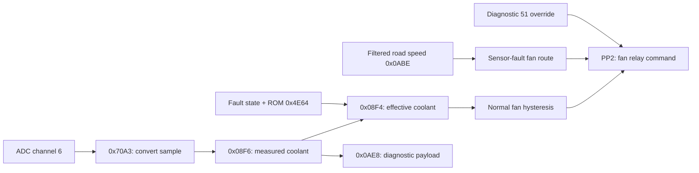

# Coolant conversion and fan control

The [temperature-profile pass](TEMPERATURE_PROFILE.md) now provides owner-corroborated coolant Celsius axes and code-equivalent fan thresholds, with resistance-curve cross-checks and an explicit XT/TDM fallback discrepancy. Varying the variant selector does not change the tested temperature conversions or fallbacks.

**Physical role: strongly corroborated by diagnostics 06 and 51. Raw algorithm: traced and behavior-tested. Celsius encoding: owner-corroborated; sensor accuracy not measured here. Connector pins and hardware confirmation: unresolved.** See [byte-backed evidence](sensor_fan_evidence.txt).

## Conversion, exactly

The shared sample word at `0x08CA` is copied to `0x08D6` at `0x7115–0x7118`. For a ten-bit left-justified sample, let `adc10` be 0–1023 and `raw16 = adc10 × 64`.

At `0x711B–0x7133`:

1. Subtract `0x0F00`, clamping a negative result to zero.
2. Shift right three bits, truncating.
3. Clamp to `0x1C00`.
4. Call `0xC276` with the result as a Q8 index and pointer bias `0x4F44`.

The **29 actual curve bytes are `0x4F47–0x4F63`**. The first three bytes at the pointer bias are not curve cells. The implied ten-bit input knots are `60 + 32 × k`, for `k = 0…28`, i.e. 60…956. Inputs beyond the endpoints clamp.

For Q8 index `q`, `k = floor(q/256)` and `f = q mod 256`. The byte result is `floor((256 × cell[k] + f × (cell[k+1] − cell[k])) / 256)`; when `f=0`, only `cell[k]` is used. This includes the descending-curve rounding behavior. The result goes to `0x08F6`.

`0x7139–0x7142` produces the diagnostic payload:

`payload = min(149, floor(measured_coolant × 160 / 256))`.

It is stored at `0x0AE8` and selected by diagnostic 06. The [earlier logger and owner confirmation](EXTERNAL_SCALE_CHECKS.md) corroborate `payload - 30` as Celsius on the XT660. Thus the internal coordinate is `code*0.625-30 °C`; the actual wire reading is truncated and capped. Neither the internal integer nor the wire byte is an ordinary Celsius or Fahrenheit value. [All 1,024 conversion outputs](coolant_conversion_samples.json) are provided for correlation with measured temperatures.

## Fault detection and substitution

The detector at `0x70A3–0x7114` runs only when:

- RAM `0x0D58 != 0x80` (copied from ROM `0x4E6D`),
- `0x08A0 & 0x04 == 0`, and
- `0x08B2 & 0x80 == 0`.

The incoming ADC high byte is invalid when **less than 7 or at least 248**. These are instruction immediates, not separate calibration bytes. With left-justified ten-bit data this corresponds to raw ADC counts below 28 or at least 992.

The first invalid observation sets pending bit `0x08B5:0x10` and `0x0BAC:0x80`. When already pending, `0x0B41 > 0x0D8A` sets fault bit `0x08B0:0x80`, change notification `0x0BD2:0x40`, and the corresponding history bit `0x08B9:0x80`. Healthy samples clear the pending flag; recovery after `0x0B4E > 0x0D8A` clears the active fault and pending-related state. Counter updates occur elsewhere; the test supplies them explicitly, so elapsed milliseconds are not claimed.

At `0x7145–0x7157`, effective coolant `0x08F4` is:

- ROM `0x4E64` (stock **144**) when fault `0x08B0:0x80` is set and mode `0x08A0:0x04` is clear;
- measured `0x08F6` otherwise.

The diagnostic payload is computed from the measured result before this substitution. A logger should expose **measured**, **effective**, and **fault** separately.

## Complete fan decision

The decision is `0x7190–0x71CC`. Only PP2 (`0x00F0` mask 4) is changed; other port bits are preserved.

First, if `0x08A0:0x04` is set and selected diagnostic `0x0BDD` equals `0x0D4B` (51), normal fan control exits without changing PP2. The diagnostic actuator routine owns the output then.

Next, the fault route is selected only when **coolant fault `0x08B0:0x80` is set AND `0x0881:0x10` is clear**. All other cases use the effective-coolant route. The physical meaning of the `0x0881:0x10` engine state still requires full tracing.

| Route | Input | Clear PP2 | Preserve prior state | Set PP2 |
|---|---|---|---|---|
| Normal/effective temperature | `0x08F4` | `< ROM[0x4BFE]` | Between thresholds, inclusive | `> ROM[0x4BFF]` |
| Sensor-fault route | `0x0ABE` | `> ROM[0x4C01]` | Between thresholds, inclusive | `< ROM[0x4C00]` |

Stock calibration:

| File offset | Storage | Value | Meaning |
|---|---|---:|---|
| `0x4BFE` | unsigned byte | 205 | Normal lower boundary; clear below 205 |
| `0x4BFF` | unsigned byte | 217 | Normal upper boundary; set above 217 |
| `0x4C00` | unsigned byte | 50 | Fault-route set-below boundary |
| `0x4C01` | unsigned byte | 60 | Fault-route clear-above boundary |
| `0x4E64` | unsigned byte | 144 | Coolant substitute value |

Thus the first set value is **218 (106.25°C)**, and the last clear value below the lower boundary is **204 (97.5°C)** under the corroborated encoding. These are internal code equivalents, not measured physical switching temperatures. At 205 or 217 the existing output state persists. It is a hysteresis controller, not a PWM fan-speed curve. Fault-route input `0x0ABE` is derived from vehicle-speed pulses through a two-stage filter (`0x9B09–0x9C69`), so those 50/60 values must not be labelled temperature.

## Other consumers and tuning dependencies

The initial coolant observation feeds uniform-axis curves at pointer bases `0x1996`, `0x32EF`, and `0x3301`, producing `0x0A08`, `0x0994`, and `0x0996` at `0x715A–0x718D`. Flags `0x0883:0x20` and `0x0884:0x08` gate initialization. The same temperature state is used elsewhere in fuel and operating-condition logic. Editing the conversion curve therefore changes more than fan operation.

The fan is also written by diagnostic routine `0xBB45`, diagnostic cleanup `0xD83C`, and initialization. The PP2 set/clear command is confirmed; electrical polarity beyond the MCU is not yet measured.

Intake temperature has a separate conversion at `0x6FC2`, cells `0x4F26–0x4F46`, with Q8 index `ADC_high × 32`. Its fault substitute is ROM `0x4E65` (80); effective value is `0x08F5`, payload `0x0AEB`. Both temperature curves have exhaustive ten-bit input fixtures.

## What would make this exportable

Correlate raw counts/internal bytes/payload with known coolant temperatures, verify fan switching on matching hardware, identify the ECU connector route, and establish checksum coverage. Then encode exact comparison boundaries and conversion rounding in the definition. The Celsius coordinate is now corroborated, but these checks are still required before enabling edited calibrations for hardware use.
