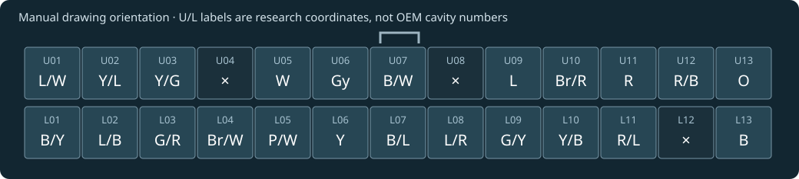

# XT ECU connector positions and MCU function links

The earlier overview left every connector cavity field blank. The manual does not print OEM cavity numbers, but it does provide a two-row wire-position pictogram. Omitting those recoverable positions was incomplete. This inventory accounts for all 26 drawn positions: 23 wire-labelled and three cross-marked.

Manual reference for 2004 XT660R/X, correlated with the supplied 2005-labelled image; exact ECU part number is unconfirmed.

As drawn in the manual, with the small tab symbol above. The inspected drawing does not state mating-face versus wire-entry view. Do not mirror or assign OEM numbers without establishing that view.

U01-U13 and L01-L13 mean upper/lower row, counted left to right in the printed drawing. They are research coordinates, not Yamaha cavity numbers.

[Open the interactive connector and MCU reference](MCU_PIN_OVERVIEW.html#ecu-connector)

## What each link establishes

Function corroborated joins the manual circuit to a firmware diagnostic identity. Candidate association is weaker. No connector-to-MCU board continuity has been measured.

A harness terminal may reach an ADC through conditioning, drive a transistor controlled by a GPIO, or join a supply/ground network serving several circuits. Package pin numbers below remain conditional on the MC9S12T64 80-pin identification. The external drawing cannot identify the intervening PCB components or make these direct electrical connections.

| Drawing position | Wire | External circuit | Related MCU signal / package pin | Link evidence |
|---|---|---|---|---|
| U01 (upper 1) | L/W | Starter-relay control network | PB1 / 21 | Candidate association |
| U02 (upper 2) | Y/L | Meter / immobilizer communication line | PS2/RxD1 / 69, PS3/TxD1 / 70 | Candidate association |
| U03 (upper 3) | Y/G | Lean-angle sensor signal | PAD5/AN5 / 64 | Function corroborated |
| U04 (upper 4) | Cross | Cross-marked position | Not established | No connection shown |
| U05 (upper 5) | W | Vehicle-speed sensor signal | PT2/IOC2 / 1 | Function corroborated |
| U06 (upper 6) | Gy | Crank-position sensor signal | PT1/IOC1 / 80 | Function corroborated |
| U07 (upper 7) | B/W | Harness ground / return | Internal rail; exact MCU joins untraced | Internal rail |
| U08 (upper 8) | Cross | Cross-marked position | Not established | No connection shown |
| U09 (upper 9) | L | Shared sensor supply | Internal rail; exact MCU joins untraced | Internal rail |
| U10 (upper 10) | Br/R | Air-induction solenoid control | PP1/PWM1 / 13 | Function corroborated |
| U11 (upper 11) | R | ECU power feed | Internal rail; exact MCU joins untraced | Internal rail |
| U12 (upper 12) | R/B | Primary fuel-injector control | PT6/IOC6 / 5 | Function corroborated |
| U13 (upper 13) | O | Ignition-coil control | PT3/IOC3 / 2 | Function corroborated |
| L01 (lower 1) | B/Y | Starting / sidestand interlock network | PB0 / 20 | Candidate association |
| L02 (lower 2) | L/B | Neutral-state input through relay unit | PB4 / 24 | Function corroborated |
| L03 (lower 3) | G/R | Coolant-temperature sensor signal | PAD6/AN6 / 65 | Function corroborated |
| L04 (lower 4) | Br/W | Intake-air-temperature sensor signal | PAD3/AN3 / 62 | Function corroborated |
| L05 (lower 5) | P/W | Intake-pressure sensor signal | PAD1/AN1 / 60 | Function corroborated |
| L06 (lower 6) | Y | Throttle-position sensor signal | PAD0/AN0 / 59 | Function corroborated |
| L07 (lower 7) | B/L | Shared sensor return | Internal rail; exact MCU joins untraced | Internal rail |
| L08 (lower 8) | L/R | Fuel-injection-system relay control | PA2 / 47 | Function corroborated |
| L09 (lower 9) | G/Y | Radiator-fan relay control | PP2/PWM2 / 14 | Function corroborated |
| L10 (lower 10) | Y/B | Headlight-relay control | PP4/PWM4 / 16 | Function corroborated |
| L11 (lower 11) | R/L | Fuel-injection relay output / system supply | PAD4/AN4 / 63 | Candidate association |
| L12 (lower 12) | Cross | Cross-marked position | Not established | No connection shown |
| L13 (lower 13) | B | Harness ground | Internal rail; exact MCU joins untraced | Internal rail |

## Circuit paths and limits

### U01 - L/W - Starter-relay control network

The drawing joins ECU L/W to the starter-relay/cut-off relay network. Filtered PB1 drives the debounced 0x0880 bit 0 state at 0xCBEF; that state participates in fault-19 and headlight suppression paths. This supports a starter-request interpretation, but the L/W-to-PB1 board route is not verified.

Related MCU function: **PB1**, conditional package pin **21**; candidate association. Firmware anchors: `0xCBEF`, `0xCBF6`, `0x8B8D`, `0x9DC0`.

### U02 - Y/L - Meter / immobilizer communication line

Y/L joins the ECU, meter and immobilizer in the manual. SCI1 RX/TX handles their software exchange; the external line interface joining both MCU signals has not been traced.

Related MCU function: **PS2/RxD1**, conditional package pin **69**; candidate association. Firmware anchors: `0x5073`, `0xCDC0`.

Related MCU function: **PS3/TxD1**, conditional package pin **70**; candidate association. Firmware anchors: `0xCCA9`, `0xCDBB`.

### U03 - Y/G - Lean-angle sensor signal

Manual signal Y/G; diagnostic 08 selects ATD5. Protection/conditioning lies between terminal and PAD5.

Related MCU function: **PAD5/AN5**, conditional package pin **64**; function corroborated. Firmware anchors: `0x71EB`, `0x6563`.

### U05 - W - Vehicle-speed sensor signal

Manual ECU-side W; diagnostic 07 and timer-2 counter identify PT2. Sensor-side wire is P; external input conditioning is not mapped.

Related MCU function: **PT2/IOC2**, conditional package pin **1**; function corroborated. Firmware anchors: `0xF3F3`, `0xF3FB`.

### U06 - Gy - Crank-position sensor signal

Manual ECU-side Gy; crank capture uses PT1/TC1. The sensor-side lead is L/Y and its return joins the harness return network. Comparator/protection route is not mapped.

Related MCU function: **PT1/IOC1**, conditional package pin **80**; function corroborated. Firmware anchors: `0x536C`, `0xD871`, `0xD8D3`.

### U07 - B/W - Harness ground / return

The diagram grounds ECU B/W and shares that return with other vehicle circuits. Exact joins to MCU ground domains require the PCB netlist.

### U09 - L - Shared sensor supply

The manual supplies TPS, MAP, lean-angle and speed sensors from L. This is a board supply rail, not an identified MCU GPIO output; no regulator or reference-pin connection is established.

### U10 - Br/R - Air-induction solenoid control

Manual Br/R runs from ECU to the air-induction solenoid; R/W is its separate supply. Diagnostic 48 commands PP1/PWM1 at PTP bit 1. An unidentified power driver lies between MCU and harness.

Related MCU function: **PP1/PWM1**, conditional package pin **13**; function corroborated. Firmware anchors: `0xBAC3`, `0xBAE5`, `0x9D51`.

### U11 - R - ECU power feed

The manual shows R entering the ECU from the vehicle power network. Internal regulation and its MCU supply destinations are not mapped; this is not a direct MCU supply-pin assignment.

### U12 - R/B - Primary fuel-injector control

Manual ECU R/B runs to the injector control terminal; R/L supplies the injector separately. Diagnostic 36 commands PT6/TC6. A power driver lies between MCU and harness. Other R/B wires elsewhere in the harness are not this ECU net.

Related MCU function: **PT6/IOC6**, conditional package pin **5**; function corroborated. Firmware anchors: `0xB97F`, `0xF519`, `0xC55B`.

### U13 - O - Ignition-coil control

Manual O runs to the ignition coil primary; diagnostic 30 commands PT3/TC3. A coil power driver separates the MCU command from this terminal.

Related MCU function: **PT3/IOC3**, conditional package pin **2**; function corroborated. Firmware anchors: `0xB900`, `0xEF50`, `0xEFDE`.

### L01 - B/Y - Starting / sidestand interlock network

Manual B/Y joins ECU to the relay/interlock network. Diagnostic 20 identifies PB0 as sidestand/start-interlock input, but this particular electrical join is not board-proven.

Related MCU function: **PB0**, conditional package pin **20**; candidate association. Firmware anchors: `0x8B45`, `0x8B57`, `0x6583`.

### L02 - L/B - Neutral-state input through relay unit

Fault-42 instructions identify relay L/Y to ECU L/B (PDF page 362). Diagnostic 21 reads filtered PB4 for variant 9. This is not the raw Sb wire at the neutral switch.

Related MCU function: **PB4**, conditional package pin **24**; function corroborated. Firmware anchors: `0x8B45`, `0x6599`, `0x65A0`.

### L03 - G/R - Coolant-temperature sensor signal

Manual G/R and diagnostic 06 identify ATD6/PAD6. Thermistor bias/protection and the exact PCB route are not mapped.

Related MCU function: **PAD6/AN6**, conditional package pin **65**; function corroborated. Firmware anchors: `0x70A3`, `0x711B`, `0x714F`.

### L04 - Br/W - Intake-air-temperature sensor signal

Manual Br/W and diagnostic 05 identify ATD3/PAD3. The input includes thermistor bias/protection.

Related MCU function: **PAD3/AN3**, conditional package pin **62**; function corroborated. Firmware anchors: `0x6FC2`, `0x7040`, `0x7060`.

### L05 - P/W - Intake-pressure sensor signal

Manual P/W and diagnostic 03 identify ATD1/PAD1. The exact conditioning route is not mapped.

Related MCU function: **PAD1/AN1**, conditional package pin **60**; function corroborated. Firmware anchors: `0x6AA5`, `0x652B`, `0xEA7F`.

### L06 - Y - Throttle-position sensor signal

Manual Y and diagnostic 01 identify ATD0/PAD0. The exact conditioning route is not mapped.

Related MCU function: **PAD0/AN0**, conditional package pin **59**; function corroborated. Firmware anchors: `0x6996`, `0x651F`.

### L07 - B/L - Shared sensor return

The manual joins sensor returns to ECU B/L. Connections to VSSA, VRL or other MCU grounds are not established by the external drawing.

### L08 - L/R - Fuel-injection-system relay control

Manual L/R runs to the fuel-injection relay control side; diagnostic 50 commands PA2. The board driver is not identified.

Related MCU function: **PA2**, conditional package pin **47**; function corroborated. Firmware anchors: `0xBB23`, `0xBB41`, `0xACD9`, `0xACE6`.

### L09 - G/Y - Radiator-fan relay control

Manual G/Y runs to the radiator-fan relay coil; diagnostic 51 commands PP2/PWM2. The fan motor has a separate supply circuit.

Related MCU function: **PP2/PWM2**, conditional package pin **14**; function corroborated. Firmware anchors: `0x71C5`, `0x71CA`, `0xBB7B`.

### L10 - Y/B - Headlight-relay control

Manual Y/B runs to the headlight relay coil; diagnostic 52 commands PP4/PWM4. The board driver is not identified.

Related MCU function: **PP4/PWM4**, conditional package pin **16**; function corroborated. Firmware anchors: `0x9DC5`, `0x9DCA`, `0xBBD7`.

### L11 - R/L - Fuel-injection relay output / system supply

Manual R/L supplies ECU, injector and fuel pump from the fuel-injection relay. ATD4/PAD4 monitors fuel-system supply; assigning this terminal to that divider remains a candidate, not a continuity result.

Related MCU function: **PAD4/AN4**, conditional package pin **63**; candidate association. Firmware anchors: `0x6C5E`, `0x6577`.

### L13 - B - Harness ground

The diagram connects ECU B to ground. The division between power, digital and analog grounds inside the ECU is not established.

## Sources and reproducibility

[Yamaha 5VK1-AE1 service manual](https://scootertuub.nl/motoren/Yamaha/Yamaha%20XT%20660%20R%20X%202004%20Service%20Manual%20%20.pdf#page=462): PDF page 462 shows the connector pictogram and circuits; page 458 gives the circuit/color legend; page 345 is the fuel-injection wiring view. Page 362 identifies the neutral route; page 379 identifies Br/R and R/W at the air-induction solenoid. These two solenoid test-probe callouts are not ECU cavity numbers.

The redraw and inventory are transcribed visual positions, not a newly numbered physical connector. The OEM numbering and face convention remain unresolved. A matching connector drawing with that convention can resolve them without requiring firmware changes. Unresolved internal signal routes need the matching ECU PCB or an equivalent circuit schematic.

Regenerate with `python scripts/build_pin_overview.py`; verify with `python scripts/verify_pin_overview.py`. Structured connector records are included in [mcu_pin_overview.json](mcu_pin_overview.json).

